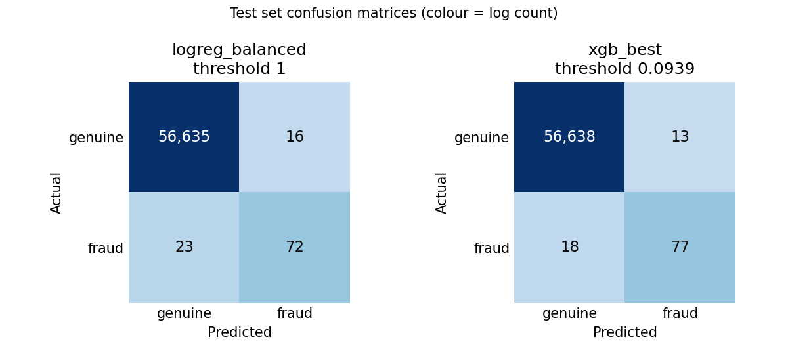
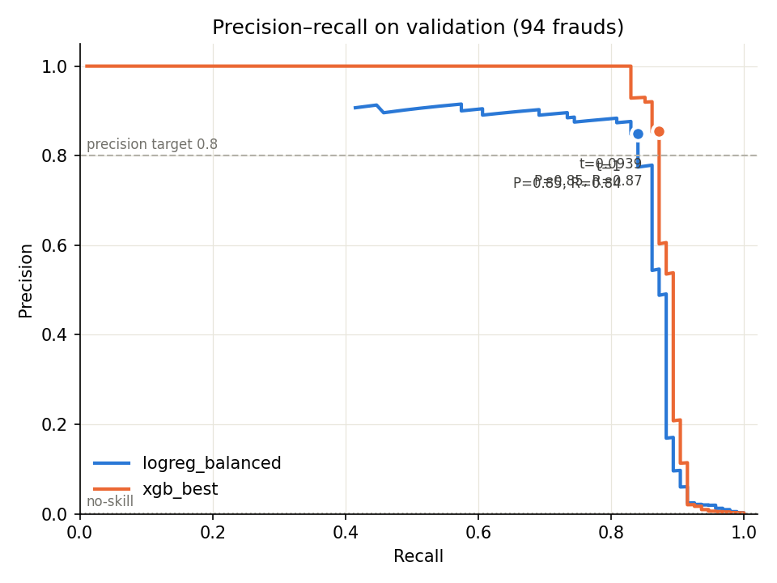
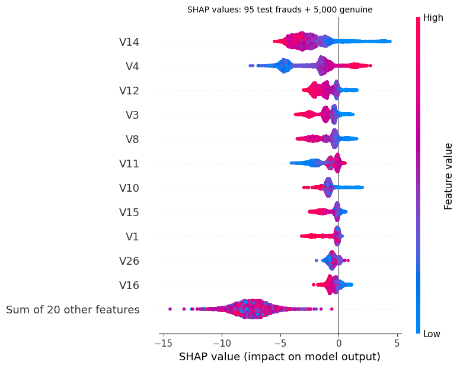

# Credit card fraud detection: rare-event classification done honestly

Detecting fraud in **284,807 card transactions** where only **0.17%** are fraudulent. The project compares
imbalance strategies under cross-validation, tunes a decision threshold on a held-out validation set, evaluates
**once** on an untouched test set with bootstrap confidence intervals, and explains the model with SHAP.

It replaces an earlier mini-project that used random undersampling + logistic regression and reported accuracy
only (a model that never predicts fraud scores 99.8% accuracy here).



## Results at a glance

Test set: 56,746 transactions, 95 frauds. Thresholds were frozen on validation before the test run.

| Model | PR-AUC [95% CI] | Precision | Recall | F1 | Frauds caught | False alarms |
|---|---|---:|---:|---:|---:|---:|
| Logistic regression, `class_weight="balanced"` | 0.681 [0.573, 0.786] | 0.818 | 0.758 | 0.787 | 72 / 95 | 16 |
| **XGBoost (tuned)** | **0.827 [0.752, 0.895]** | **0.856** | **0.811** | **0.832** | **77 / 95** | **13** |

No-skill PR-AUC (a random ranking) equals the fraud rate, about **0.0017**.

Paired bootstrap (2,000 stratified resamples, both models scored on the same resample), XGBoost − baseline:

| Metric | Mean difference | 95% CI | XGBoost better in |
|---|---:|---|---:|
| PR-AUC | +0.145 | +0.071 to +0.226 | 100% of resamples |
| Recall | +0.053 | +0.011 to +0.105 | 99.4% |
| F1 | +0.046 | +0.001 to +0.095 | 97.8% |
| Precision | +0.038 | −0.039 to +0.118 | 82.2% (not significant) |

**In plain terms:** at the same threshold rule, XGBoost catches 5 more of 95 frauds with 3 fewer false alarms.
The PR-AUC and recall gains are robust; the precision gain is not.

## Key findings

1. **Handling imbalance didn't improve ranking; it moved the operating point.** For logistic regression,
   no reweighting, SMOTE and class weights tied on 5-fold CV PR-AUC (0.736, 0.736, 0.734; fold-to-fold
   SD about 0.05, no consistent winner). They differed only in where a 0.5 threshold lands (precision 0.85 vs
   0.05). Tuning the threshold does that directly and transparently.
2. **Random undersampling (the old approach) was worst on every fold**: CV PR-AUC 0.504 ± 0.160. Training on
   about 450 rows throws away 99.8% of genuine transactions.
3. **Model family mattered; tuning didn't.** XGBoost beat balanced logistic regression on all 5 CV folds
   (PR-AUC 0.850 vs 0.734, mean +0.116). The top 10 of 25 searched configurations were within 0.011 of each
   other, against a fold SD of about 0.068.
4. **ROC-AUC misleads on rare events.** Three times in this project it pointed the wrong way: undersampling had
   the highest CV ROC-AUC (0.982) and the lowest PR-AUC; logistic regression had 0.98 ROC-AUC with 5% precision
   at threshold 0.5; XGBoost had lower validation ROC-AUC than the baseline (0.972 vs 0.982) but much higher
   PR-AUC.
5. **The 18 missed frauds look genuine to the model.** Their median predicted probability is 6.3×10⁻⁵, so no
   sensible threshold catches them. SHAP shows the most confidently missed one scored low because V4 and V14,
   the model's two strongest signals, both pointed to "genuine".

## Method

| Step | What | Where |
|---|---|---|
| 1. Data and split | Data checks; 1,081 exact duplicate rows (19 frauds) dropped **before** splitting; 0 rows with conflicting labels; stratified 60/20/20 split (train 170,235 / val 56,745 / test 56,746; fraud rate 0.166–0.167% in each) | `src/split_data.py` |
| Preprocessing | `log1p` + standardisation of Amount; Time (seconds over 2 days) → sin/cos of a 24-hour cycle; V1–V28 standardised for linear models only. All fitted **inside** model pipelines | `src/features.py` |
| 2. Baseline | Balanced logistic regression; precision, recall, F1, PR-AUC (no accuracy) | `src/baseline.py` |
| 3. Imbalance strategies | None vs class weights vs random undersampling vs SMOTE, 5-fold stratified CV on train only; samplers inside an `imblearn` Pipeline so validation folds are never resampled | `src/compare_imbalance.py` |
| 4. Tree model | XGBoost, 25-config randomized search over 5 folds (same folds as step 3, so comparisons are paired); `scale_pos_weight` searched | `src/tree_model.py` |
| 5. Threshold | Highest recall with precision ≥ 0.80 on **validation**, per model; trade-off table at other targets | `src/threshold.py` |
| 6. Test | One run, frozen models and thresholds, guarded against re-runs; stratified + paired bootstrap CIs | `src/final_test.py` |
| 7. Explain | Exact TreeSHAP via XGBoost (`pred_contribs`), additivity verified; global importance and two example predictions | `src/explain.py` |

Every data and modelling decision is logged in [`docs/DECISIONS.md`](docs/DECISIONS.md).

### Threshold trade-off (validation, XGBoost)

| Rule | Threshold | Precision | Recall | False alarms |
|---|---:|---:|---:|---:|
| Default | 0.5 | 0.930 | 0.851 | 6 |
| Recall @ precision ≥ 0.5 | 0.013 | 0.538 | 0.894 | 72 |
| **Recall @ precision ≥ 0.8 (chosen)** | **0.094** | **0.854** | **0.872** | **14** |
| Recall @ precision ≥ 0.9 | 0.314 | 0.920 | 0.862 | 7 |

Between thresholds 0.023 and 0.094, recall stayed at 82/94 while false alarms fell from 50 to 14: the
threshold mainly trades false alarms, not caught frauds.



### What drives the predictions (SHAP, test set)



Top features by mean |SHAP| (log-odds): V14 (2.70), V4 (2.52), V12 (1.22), V3 (1.10), V8 (1.04). V14 matters
even more on frauds (3.25), while V4 matters less on frauds (1.40): it mostly helps clear genuine transactions.
The same components carry the largest logistic-regression coefficients, so two model families agree.

## Run it

```bash
python3 -m venv .venv && source .venv/bin/activate
pip install -r requirements.txt
brew install libomp                      # macOS only: XGBoost needs OpenMP
# download creditcard.csv from Kaggle ("Credit Card Fraud Detection", ULB Machine Learning Group) into data/raw/
python -m src.split_data
python -m src.baseline
python -m src.compare_imbalance
python -m src.tree_model
python -m src.threshold
python -m src.final_test                 # runs once; --rerun to override
python -m src.explain
```

```
src/        one script per step, plus config.py, features.py, evaluate.py
reports/    tables/ (CSV/JSON output of every step) and figures/
docs/       DECISIONS.md
data/       raw/ and processed/ (not committed)
models/     saved pipelines (not committed)
```

## Limitations

- **Anonymised features.** V1–V28 are PCA components, so SHAP says *which* components matter, not *what* they
  mean. No feature engineering on customer or merchant history was possible.
- **One dataset, two days.** All transactions come from about 48 hours; results may not hold for other periods,
  regions or card portfolios.
- **Random, not time-based, split.** The model trains on some transactions that happen after test ones. A real
  system always predicts the future, so this likely flatters performance somewhat.
- **No cost model.** The precision target of 0.80 (at most 1 in 5 alerts is false) is an assumption. With
  real costs of a missed fraud and of reviewing an alert, the threshold should be set to minimise expected cost.
- **Few frauds, wide intervals.** 94 validation and 95 test frauds: one fraud is about 1 point of recall. Logistic
  regression's PR-AUC was 0.734 (CV), 0.790 (validation) and 0.681 (test) for the same model family.
- **The tuned threshold didn't maximise test F1.** At 0.5, XGBoost had test F1 0.866 (74 caught, 2 false alarms)
  vs 0.832 at the tuned threshold (77 caught, 13 false alarms), because the rule targets recall, not F1. The
  threshold was not re-tuned after seeing test results, since that would leak.
- **XGBoost memorises training frauds** (train PR-AUC 1.000 vs 0.850 CV). Held-out performance is still the
  best of the models tested, but this gap is a reason to retrain and monitor on new data.
